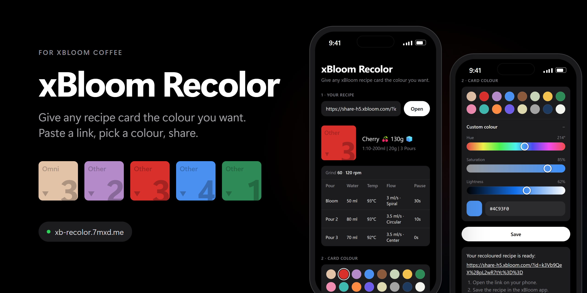

<p align="center"></p>

# xBloom Recolor

Change the card colour of an xBloom recipe, which the official app doesn't let you do.
No login for users.

**Live:** https://xb-recolor.7mxd.me

1. Paste your recipe's share link (`https://share-h5.xbloom.com/?id=…`). Its details show up, read-only.
2. Pick a colour: presets, or *Custom colour* (hue / saturation / lightness, hex, or the system picker).
3. Click **Save**. You get a new share link. Open it in the xBloom app and save it, and
   the recoloured card appears under *My Recipes → Shared*.

## How it works

A share link points at a recipe in its creator's account, and only that account can
change it. So the site keeps one **service account** of its own: on Save, the server
re-reads the recipe from the link, saves a copy with the new `theColor` into the service
account, and returns that copy's share link.

| Step | xBloom endpoint | Auth |
|---|---|---|
| Open | `RecipeDetail.html` | none (public share endpoint) |
| Log in | `tMemberLogin.thtml` | service account |
| Find existing copy / new link | `tuMyTeaRecipeCreated.tuhtml` | token, RSA-encrypted body |
| Save copy | `tuRecipeAdd.tuhtml` | token, RSA-encrypted body |

- **No duplicates:** if the same recipe was already saved in the same colour, the
  existing link is returned instead of creating another copy.
- **Rate limit:** 10 saves per IP and 100 in total per hour, per server instance
  (`lib/handlers.js`).
- **Don't delete copies from the service account.** People may have saved them from
  their links.

The protocol is based on [xbloom-py](https://github.com/Alshekhi/xbloom-py) and
[XBRecipeWriterPlus](https://github.com/hessius/XBRecipeWriterPlus).

## Setup

1. Create a **new, dedicated** xBloom account (not your personal one).
2. Provide its credentials as environment variables, never in code:

   ```sh
   XBLOOM_EMAIL=...
   XBLOOM_PASSWORD=...
   ```

## Run locally

Requires Node 20.6+. No dependencies.

```sh
cp .env.example .env   # fill in the service account
npm run dev            # http://localhost:3000
npm test
```

## Deploy on your own subdomain

**Vercel (free):** import the repo and add `XBLOOM_EMAIL` and `XBLOOM_PASSWORD` as
environment variables. `vercel.json` already sets the build (`public/` is the site, `api/`
the backend, no build step), so ignore any "configuration mismatch" warning; `server.js`
is excluded via `.vercelignore`. Then *Settings → Domains → add* your subdomain and create
the `CNAME` record Vercel shows. On Cloudflare, set it to **DNS only** (grey cloud) or the
HTTPS certificate won't issue.

**Your own server/VPS:** set the two env vars and run `node server.js` (`PORT` optional)
behind nginx/Caddy with HTTPS.

## Caveats

- Unofficial, undocumented API. xBloom can change or block it at any time.
- Not affiliated with xBloom.
